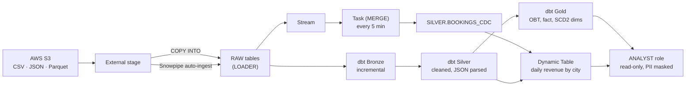

# Config-Driven Snowflake ELT Framework

An end-to-end ELT pipeline on Snowflake. CSV, JSON and Parquet files land in AWS S3
and load into Snowflake with `COPY INTO` and Snowpipe. Streams and Tasks merge new
rows incrementally, a Dynamic Table keeps a Gold summary fresh, and config-driven
dbt models build Bronze, Silver and Gold layers with SCD Type 2 snapshots and data
tests. Access is controlled with least-privilege roles and a PII masking policy,
cost is capped by a resource monitor, and GitHub Actions runs `dbt build` on every
pull request.

**Tech stack:** Snowflake · dbt · AWS S3 · SQL · Jinja · Python (pandas, PyArrow) · GitHub Actions · uv

---

## Architecture



**Two paths through the pipeline:**

- **Batch (dbt):** RAW → Bronze → Silver → Gold, run by `dbt build` locally or in CI.
- **Near real time (Snowflake-native):** a new file in S3 → Snowpipe → RAW → Stream →
  Task MERGE → CDC table → Dynamic Table, with no job to run by hand.

---

## Features

| Feature | Implementation | Why |
|---|---|---|
| Virtual warehouse and cost control | `snowflake/00_warehouse_and_monitor.sql` | X-Small warehouse, 60s auto-suspend, resource monitor that notifies at 80% and suspends at 100% |
| Role-based access control | `snowflake/01_roles_and_grants.sql` | LOADER, TRANSFORMER and ANALYST with least privilege and future grants |
| External stage | `snowflake/02_external_stage.sql` | One reusable pointer to the S3 landing zone |
| File formats | `snowflake/03_file_formats.sql` | Named CSV, JSON and Parquet formats reused by every load |
| Batch ingestion | `snowflake/04_raw_tables_and_copy.sql` | `COPY INTO` with file-name and load-time lineage, checked with `COPY_HISTORY` |
| Near-real-time ingestion | `snowflake/05_snowpipe.sql` | Snowpipe auto-ingest triggered by S3 event notifications |
| Incremental CDC | `snowflake/06_streams_and_tasks.sql` | A stream tracks new rows; a task MERGEs them only when the stream has data |
| Self-refreshing summary | `snowflake/07_dynamic_tables.sql` | Dynamic Table with a 15-minute target lag |
| PII masking | `snowflake/08_masking_policy.sql` + dbt post-hooks | Host names masked for ANALYST, reattached after every dbt rebuild |
| CI service user | `snowflake/09_ci_service_user.sql` | Key-pair authentication, no password, TRANSFORMER role only |
| Config-driven transformations | `dbt/models/` | Bronze, Silver and Gold models built from Jinja config lists and macros |
| SCD Type 2 | `dbt/snapshots/` | Check-strategy snapshots for hosts, listings and bookings |
| Data quality | `dbt/models/*/schema.yml` | `unique`, `not_null`, `relationships` and `accepted_values` tests on every layer |
| Continuous integration | `.github/workflows/dbt-ci.yml` | `dbt build` on every pull request, in isolated `CI_` schemas |

---

## Data formats

| Dataset | Format | How it's loaded |
|---|---|---|
| Bookings | CSV | `COPY INTO` and Snowpipe, matched by header names |
| Hosts | Parquet | `COPY INTO`, matched by column names |
| Listings | JSON (nested `address` object) | Landed whole in a `VARIANT` column, parsed in Silver with path notation and casts |

The JSON and Parquet files are created from the source CSVs by
`scripts/convert_formats.py`.

---

## dbt layers

| Layer | Models | What happens |
|---|---|---|
| Bronze | `bookings`, `hosts`, `listings` | Incremental loads from RAW on `loaded_at` (only rows that arrived since the last run) |
| Silver | `silver_bookings`, `silver_hosts`, `silver_listings` | Cleaning, derived columns, JSON parsing, incremental merges on business keys |
| Gold | `obt`, `fact` | One big table and a booking fact table, both built from Jinja config lists |
| Snapshots | `dim_bookings`, `dim_host`, `dim_listing` | SCD Type 2 history with `dbt_valid_from` and `dbt_valid_to` |

Reusable macros: `multiply`, `tag` (price bands), `trimmer`, and a custom
`generate_schema_name` that routes CI builds into `CI_` schemas.

---

## Security model

| Role | Access |
|---|---|
| LOADER | Owns `RAW`: the stage, file formats, landing tables and Snowpipe |
| TRANSFORMER | Reads `RAW`; owns Bronze, Silver and Gold; runs dbt, the task and the Dynamic Table |
| ANALYST | Read-only on Gold; sees host names masked (for example `T*****`) |

- **Masking:** the policy lives in a separate `GOVERNANCE` schema, which dbt can apply but not change.
- **Isolated roles:** secondary roles are disabled, so each role only has its own privileges.
- **Credentials never live in the repo:** scripts use placeholders, local secrets sit in a
  git-ignored `.env`, and CI reads them from GitHub Secrets.

---

## Cost controls

- **X-Small warehouse** with a 60-second auto-suspend, so it only bills while queries run.
- **Resource monitor** with a monthly credit quota: notifies at 80%, suspends at 100%.
- **Task skips when idle:** its `WHEN SYSTEM$STREAM_HAS_DATA` condition is checked without
  waking the warehouse, so runs with no new data cost nothing.
- **Demo objects stay paused:** the pipe, task and Dynamic Table are suspended when not in use.

---

## Design decisions

- **One owner per table.** The task owns `BOOKINGS_CDC` and dbt owns its models, so two
  processes never write to the same table.
- **Masking survives rebuilds.** dbt replaces Gold tables, which drops column policies, so
  post-hooks reattach the policy after every build.
- **CI never touches real tables.** It builds into `CI_BRONZE`, `CI_SILVER` and `CI_GOLD`,
  which protects SCD2 history and the tables analysts use.
- **The stage uses a scoped IAM user.** The AWS account's organization policy blocks
  cross-account role access, so the stage uses a dedicated IAM user with a read-only
  policy on the `raw/` prefix. In production, a storage integration would replace the keys.
- **JSON stays raw in RAW.** Listings land whole in a `VARIANT` column and are parsed in
  Silver, so a new field in the source never breaks the load.

---

## Repo structure

```
dbt/
  models/          bronze, silver, gold models and schema.yml tests
  snapshots/       SCD Type 2 snapshot configs
  macros/          reusable SQL macros
  tests/           singular tests
  profiles.yml.example
snowflake/         numbered Snowflake setup scripts (run in order)
scripts/           convert_formats.py, make_test_bookings.py
docs/              screenshots
.github/workflows/ dbt CI workflow
```

---

## How to run

**Prerequisites:** a Snowflake account (Enterprise edition, for masking), an S3 bucket
with the source files under `raw/`, and [uv](https://docs.astral.sh/uv/).

1. **Install dependencies**
   ```bash
   uv sync
   ```
2. **Set up Snowflake:** run `snowflake/00` to `09` in order in a Snowflake worksheet.
   Fill in the stage credentials and the CI public key in the worksheet only; never commit them.
3. **Configure dbt:** create `~/.dbt/profiles.yml` with role `TRANSFORMER`, warehouse
   `ELT_WH` and database `RENTALS_DB` (see `dbt/profiles.yml.example`).
4. **Build**
   ```bash
   cd dbt
   uv run dbt build
   ```
5. **Test Snowpipe:** create a file of new bookings and upload it to `raw/bookings/`.
   ```bash
   uv run python scripts/make_test_bookings.py
   ```
   Then run `dbt build` again, and the incremental models pick up only the new rows.

---

## CI/CD

Every pull request to `main` triggers `.github/workflows/dbt-ci.yml`:

1. Installs dependencies with uv.
2. Writes the dbt profile and private key from GitHub Secrets.
3. Runs `dbt debug`, then `dbt build --full-refresh` in isolated `CI_` schemas.

CI authenticates as `DBT_CI`, a Snowflake service user with key-pair authentication
and the TRANSFORMER role only.

---

## Screenshots

| | |
|---|---|
| dbt lineage |  |
| COPY INTO history |  |
| Task history (merge and skip) |  |
| CI passing on a pull request |  |

<!-- Add when available:
| Masking: TRANSFORMER (real names) |  |
| Masking: ANALYST (masked names) |  |
-->
