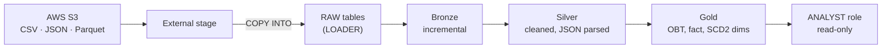

# Config-Driven Snowflake ELT Framework

An ELT pipeline on Snowflake that loads CSV, JSON and Parquet files from AWS S3
with `COPY INTO`, then transforms them through Bronze, Silver and Gold layers
with config-driven dbt models, SCD Type 2 snapshots and data tests. It runs
under least-privilege roles on a cost-capped X-Small warehouse.

## Architecture



## What's built

| Feature | Where | Why |
|---|---|---|
| X-Small warehouse, 60s auto-suspend, resource monitor | `snowflake/00_warehouse_and_monitor.sql` | Pay only while queries run; monthly credit cap |
| LOADER, TRANSFORMER, ANALYST roles with future grants | `snowflake/01_roles_and_grants.sql` | Least-privilege access per layer |
| External S3 stage | `snowflake/02_external_stage.sql` | One reusable pointer to the landing zone |
| CSV, JSON and Parquet file formats | `snowflake/03_file_formats.sql` | Reusable parsing rules per format |
| RAW tables loaded with `COPY INTO`, with file lineage | `snowflake/04_raw_tables_and_copy.sql` | Idempotent bulk loads, tracked in `COPY_HISTORY` |
| Bronze, Silver, Gold dbt models built from Jinja config lists | `dbt/models/` | Reusable, config-driven transformations |
| SCD Type 2 snapshots (check strategy) | `dbt/snapshots/` | Track changes to hosts, listings and bookings |
| 26 data tests (unique, not_null, relationships, accepted_values) | `dbt/models/*/schema.yml` | Validate every layer |

## Data formats

| Dataset | Format | How it's loaded |
|---|---|---|
| Bookings | CSV | `COPY INTO` matched by header names |
| Hosts | Parquet | `COPY INTO` matched by column names |
| Listings | JSON (nested `address`) | Landed in a `VARIANT` column, parsed in Silver |

## Repo structure

```
dbt/         dbt project (models, snapshots, tests, macros)
snowflake/   numbered Snowflake setup scripts, run in order
scripts/     Python helper that creates the JSON and Parquet files
docs/        screenshots
```

## How to run

1. Run `snowflake/00` to `04` in order in a Snowflake worksheet. Fill in the
   stage credentials in the worksheet only; never commit them.
2. Set up `~/.dbt/profiles.yml` with role `TRANSFORMER` and warehouse `ELT_WH`.
3. From `dbt/`: `uv run dbt build`.

## Roadmap

- Snowpipe auto-ingest for new files
- Streams and Tasks for incremental CDC
- Dynamic Table for a self-refreshing Gold summary
- Masking policy on PII columns
- GitHub Actions CI running `dbt build` on every pull request